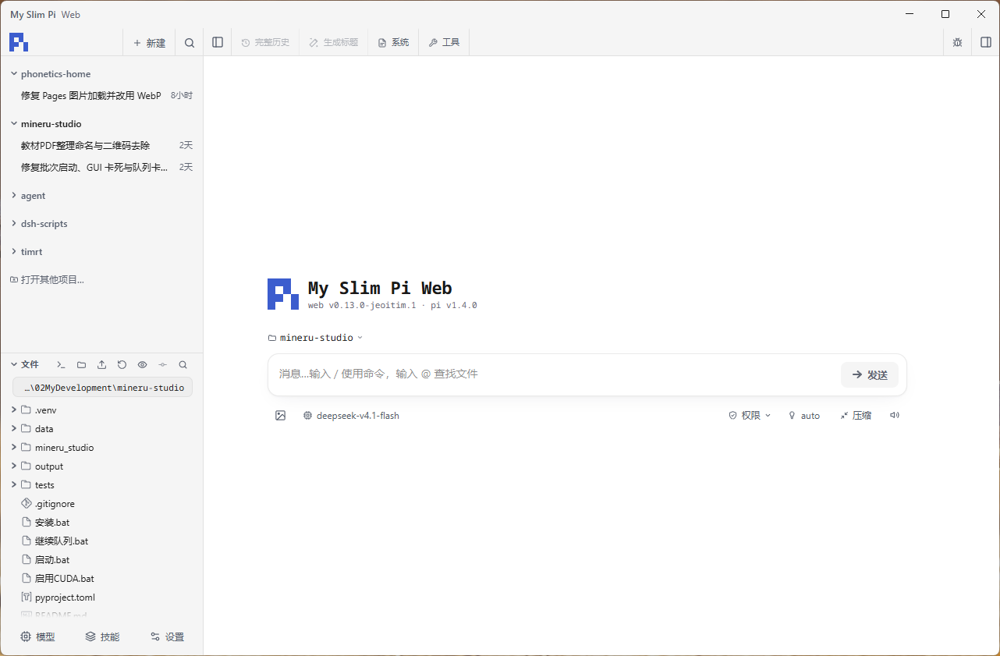

<p align="center"><a href="https://github.com/Jeoitim/my-slim-pi"></a></p>
<h1 align="center">My Slim Pi Web</h1>
<p align="center">同一个 My Slim Pi，浏览器与桌面两种入口。</p>
<p align="center"><em>Every complexity must justify its existence.</em></p>

为 [My Slim Pi](https://github.com/Jeoitim/my-slim-pi) 提供轻量的 **Web UI 与桌面应用**：在图形界面中继续对话、管理项目与会话、查看文件和工具执行、处理审批，并使用本地终端。工具、扩展、记忆、技能和权限规则继续由 My Slim Pi 提供，保留 CLI 项目以用户控制为先的使用方式。

> **必须先安装并初始化 [My Slim Pi CLI](https://github.com/Jeoitim/my-slim-pi#安装)。Web UI 和桌面应用依赖该项目，不能脱离它独立使用。** 桌面安装包自带 Node.js 运行时，但不代替 CLI 的安装、扩展、模型配置或账号初始化。

[下载桌面应用](https://github.com/Jeoitim/my-slim-pi-web/releases/latest) · [安装 My Slim Pi CLI](https://github.com/Jeoitim/my-slim-pi#安装) · [本版发布说明](docs/releases/0.13.0-jeoitim.1.md) · [桌面使用文档](docs/desktop.md)



*Windows 桌面版，浅色主题。左侧集中管理项目、会话和文件，中间选择模型并开始对话。*

## 可以做什么

| 功能 | 使用体验 |
| --- | --- |
| 对话与模型 | 流式显示回复，选择模型和思考级别，使用 Markdown、代码块、图片与文件引用；输入 `/` 使用命令，输入 `@` 查找项目文件。 |
| 项目与会话 | 按项目组织会话，搜索、置顶、归档、重命名和分叉，选择项目目录与 Git worktree，继续已有历史。 |
| 处理过程 | 默认折叠连续思考与工具调用，保留正在进行的最新一行；需要时展开查看，长过程在区域内滚动。 |
| 完整历史 | 打开带分支树的完整会话，查看思考、工具记录和图片，在历史分支之间切换。 |
| 文件与改动 | 浏览项目文件，预览源码、图片、SVG 和表格，查看 Git 状态与差异，也可上传文件供对话使用。 |
| 本地终端 | 在项目目录打开原生终端，自动识别系统已安装的 Shell，并切换到 PowerShell、CMD、Git Bash 等终端。 |
| 权限与审批 | 查看并切换 My Slim Pi 的 AUTO / ACT / ASK / PLAN 状态，在界面中处理原有扩展发出的审批和提问。 |
| 模型、技能与 MCP | 管理模型与供应商、查看技能、配置原生 MCP，沿用 My Slim Pi 的工具和任务代理授权。 |
| 桌面使用 | 独立窗口、明暗主题、文本右键菜单、系统剪贴板、简洁加载页，以及可配置的本地 Web 入口与后台运行。 |
| 浏览器使用 | 在桌面或手机浏览器访问同一 Web 界面；需要跨设备访问时，可按文档配置带认证的入口。 |

## 先安装 CLI

前往 **[Jeoitim/my-slim-pi](https://github.com/Jeoitim/my-slim-pi)**，按所在系统完成安装，再按该仓库的说明配置模型、账号与所需工具。当前适配 **Pi 1.4.0**。

默认使用的 Agent 目录为 `~/.pi/agent`。Web、桌面与 CLI 复用这一套资源和会话格式；自定义安装位置时，启动前用 `PI_CODING_AGENT_DIR` 指向实际 Agent 目录。

| 环境 | 使用方式 |
| --- | --- |
| Windows x64 | CLI 使用 PowerShell 7；本仓库提供 NSIS 桌面安装包，也可从源码运行 Web。 |
| Linux x64 | CLI 使用原生 Bash / Node；支持从源码运行 Web，AppImage 在原生构建成功时提供，Linux 图形桌面仍需目标环境验证。 |
| macOS | CLI 与桌面尚未完成实机验证，不能将 Linux 支持视为 macOS 已支持。 |

Windows 与 Linux 应分别安装各自的原生依赖，使用各自的 Agent 目录；不要在 WSL 中调用 Windows 安装目录里的 CLI。

## 使用桌面应用

1. 完成上面的 [My Slim Pi CLI 安装](https://github.com/Jeoitim/my-slim-pi#安装)。
2. 从 [GitHub Releases](https://github.com/Jeoitim/my-slim-pi-web/releases/latest) 下载对应系统的安装包和同名 `.sha256` 校验文件。
3. 完全退出旧版应用后安装并启动，打开项目目录，选择模型开始对话。

当前版本为 **`0.13.0-jeoitim.1`**。

| 下载 | 说明 |
| --- | --- |
| [Windows x64 安装包](https://github.com/Jeoitim/my-slim-pi-web/releases/download/v0.13.0-jeoitim.1/My.Slim.Pi.Web.Setup.0.13.0-jeoitim.1.exe) | 可选择安装位置；自带独立 Node.js 24、npm/npx。 |
| [Windows SHA-256](https://github.com/Jeoitim/my-slim-pi-web/releases/download/v0.13.0-jeoitim.1/My.Slim.Pi.Web.Setup.0.13.0-jeoitim.1.exe.sha256) | 用于核对下载的安装包。 |
| [Linux x64 AppImage](https://github.com/Jeoitim/my-slim-pi-web/releases/tag/v0.13.0-jeoitim.1) | 以本版附件为准；下载后赋予执行权限再运行。 |

桌面版与 Web 使用同一套界面和 Agent 后端。“设置 → 桌面应用”中可管理本地 Web 入口、登录密码和端口。Windows 的 Web 密码使用系统加密保存；修改或删除密码会重启后端，有运行任务时按界面提示处理。

关闭窗口时如有正在执行的任务、审批等待或后台代理，可以选择继续在后台运行，也可以停止任务并退出；从托盘可以再次打开窗口。安装新版本会保留已有 Agent 目录和用户配置。当前安装包未签名。

自定义 Agent 目录的 Windows 示例：

```powershell
$env:PI_CODING_AGENT_DIR = "C:/path/to/agent"
# 在此环境中启动已安装的 My Slim Pi Web 桌面应用。
```

## 从源码运行 Web

先准备已安装并构建完成的 My Slim Pi，以及 **Node.js 24+（含 npm）**。

```sh
git clone --branch my-slim-pi-web https://github.com/Jeoitim/my-slim-pi-web.git
cd my-slim-pi-web
npm ci
npm run dev
```

打开 [http://127.0.0.1:30141](http://127.0.0.1:30141)。默认仅监听本机，使用 `~/.pi/agent`。

自定义安装目录时，在启动命令之前设置：

```powershell
# Windows / PowerShell 7
$env:PI_CODING_AGENT_DIR = "C:/path/to/agent"
npm run dev
```

```bash
# Linux / Bash
export PI_CODING_AGENT_DIR="/path/to/agent"
npm run dev
```

生产运行时，先停止本仓库的开发服务器，再执行：

```sh
npm run build
npm start
```

### 远程访问

桌面应用的“本地 Web 入口”与源码启动的 Web 都可作为浏览器入口。跨设备访问前，请按 [Cloudflare Tunnel + Access 配置文档](docs/remote-access.md) 设置 Web 密码、允许的域名、HTTPS 和访问认证。远程界面保留既有权限与审批规则，部分维护接口只允许本机使用。

## 常用设置

### 思考与工具调用折叠

“**设置 → 常规 → 对话 → 默认折叠处理详情**”默认开启。

- 从第一次思考或工具调用开始折叠，运行时显示最新一行，沿用原有思考和工具卡片样式。
- 折叠区域保留滚动提示，可回看最近活动；点击展开后查看完整过程，长内容在限定高度内滚动。
- 任务完成后隐藏最新一行预览，保留可展开的过程记录与最终回复。
- 关闭开关即可恢复原有平铺显示，过程区域不再限制高度或增加内部滚动。

### 终端与 Shell

在文件区打开终端，点击终端头部的 Shell 选择器即可切换。Windows 自动检测 PowerShell 7、Windows PowerShell、CMD 与 Git Bash；Linux 按本机可用情况检测 Bash、Zsh、Fish 和 Sh。只显示系统中实际找到的 Shell，切换时已有终端和任务继续保留。

### 权限与 My Slim Pi 设置

输入框下方的权限菜单显示当前会话的真实状态：**AUTO / ACT / ASK / PLAN**。具体操作是否可执行，继续由 CLI 的权限策略决定；ASK 的非只读操作逐次人工审批，PLAN 保持只读。

“**设置 → My Slim Pi**”中的 AUTO/ACT 人工审批提醒控制原有人工兜底行为：开启时最多等待 90 秒；关闭后需要人工兜底的操作直接拒绝。ASK 仍逐次等待用户审批。后台模型入口调用 CLI 原有设置，工具与任务代理授权沿用 CLI。

旧版 CLI 若缺少兼容状态接口，请先按 CLI 的更新、备份与构建流程升级；配套源码补丁见 [权限状态补丁](patches/my-slim-pi-permission-status.patch)。本应用不会自动覆盖现有 CLI 安装或凭据。

## 开发与维护

```sh
npm run typecheck
npm run lint
npm test
npm run test:permissions
npm run test:desktop
```

桌面开发与打包：

```sh
npm run desktop:dev
npm run desktop:build
npm run desktop:pack
```

Windows x64 生成 NSIS 安装包，Linux x64 生成 AppImage，均需在对应原生系统构建。桌面生产资源位于 `.desktop/`，与 Web 开发使用的 `.next/` 分开。

本 fork 的开发分支为 `my-slim-pi-web`。版本采用 `<上游基准版本>-jeoitim.<修订号>`；当前基于 **pi-web 0.13.0**（`d128bae`），Pi SDK 依赖精确固定为 **1.4.0**。上游更新经独立集成 PR 审查后合入，本应用通过本仓库发布更新，不使用上游 npm 自动更新通道。

[桌面说明](docs/desktop.md) · [权限与配置](docs/permissions.md) · [兼容性记录](docs/compatibility.md) · [上游同步](docs/upstream.md) · [发布流程](docs/release.md)

## 来源

本项目基于 [agegr/pi-web](https://github.com/agegr/pi-web)，保留上游 Git 历史和 [MIT 许可证](LICENSE)。蓝色 Pi 标志沿用 My Slim Pi 的块状图形，标语延续 [CLI 项目](https://github.com/Jeoitim/my-slim-pi) 的设计原则；截图为实际 Windows 桌面界面。
