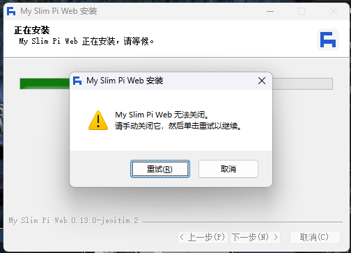

# Windows 安装失败交接（未解决）

## 最新用户反馈

最终交付的 `.2` 包仍被用户报告无法安装。窗口提示“My Slim Pi Web 无法关闭。请手动关闭它，然后单击重试以继续。”；用户进一步说退出时还有类似 **`failed to uninstall old version`** 的标语。这是用户转述，完整第二条文案和错误码尚未取得。

用户给出的安装目录为 `C:\Users\timrt\AppData\Local\Programs\MySlimPiWeb`。之前检查时宿主为 `.1`，但后续安装尝试可能改变现场，必须重新读取，不要沿用旧状态。

## 正确的代码位置

- 主开发 checkout：`C:/Users/timrt/Documents/02MyDevelopment/my-slim-pi-web`。
- 分支：`my-slim-pi-web`，安装修订基于提交 `d8807d1`；本交接另作文档提交。
- 会话默认目录可能是 `C:/Users/timrt/.codex/worktrees/upstream-baseline-validation/my-slim-pi-web`，它仍是 `2a330cc` 的 detached 旧验证工作树，不能拿它代替当前产品源码。
- 开始先查 `git status`、分支、HEAD 和 worktree 清单。不要擅自更新旧验证工作树或上游镜像。

## 当前构建指纹

用户要求继续保持 **`0.13.0-jeoitim.2`**，不要推进 `.3`。

- 安装包：`dist-desktop/My.Slim.Pi.Web.Setup.0.13.0-jeoitim.2.exe`。
- 最后交付大小：291,696,271 字节。
- SHA-256：`c83917a4b220491c6dcb0c2e3b3d333fbb97e13655fc11f69adf7ab0e195a269`。
- Web BUILD_ID：`f1mbYdzsmzq4cenza2gjL`。
- 窗口中的 `.2` 不足以证明实跑文件就是这一构建，先核对用户实际执行文件的路径、大小和 SHA。
- 失败的 `.3` 在 `dist-desktop/previous/failed-jeoitim.3/`；原 `.2` 在 `dist-desktop/previous/0.13.0-jeoitim.2-original/`。不要误交付旧包。

## 已确认与尚未确认

已确认源码事实：electron-builder 26.15.3 多处复用 `appCannotBeClosed`，所以它不等于“确实有应用在运行”。当前 ZIP 新包已避开新的 7z 临时复制分支，但仍可能调用已经安装的旧卸载器。

最新退出提示与 `include/installUtil.nsh` 的 `handleUninstallResult` 吻合：当旧卸载器结果 `$R0 != 0` 时，显示 `$(uninstallFailed): $R0`，再退出。`messages.yml` 的英文为 `Failed to uninstall old application files. Please try running the installer again.`。应优先验证这个链路；转述本身还不能证明是哪个文件、权限、路径或进程导致失败。

以前读检查时没有发现目标路径的运行进程，全部 16,081 个文件可打开读写；这些只说明检查当时的状态，不能排除安装时的瞬时占用，也不能代替实际卸载器日志。此前没有在用户真实目录执行覆盖安装或卸载。

此前那份 `Uninstall MySlimPiWeb.exe` 为 161,102 字节，SHA-256 为 `e497ffbd90516276012d28b72750443b6d7cdd67a2555a86d19288a73ac0978c`。这是旧观测指纹，后续安装尝试可能改动它，当前必须重新核对。

**具体 Windows 根因仍未知。不得写“已经证明是进程误判”“已证明是 7z 复制”或“已实机修复”。**

## 已做过的改动与验证边界

1. `154611c`：添加 `electron/installer/process-check.nsh` / `app-processes.ps1`，使用无 profile 的系统 PowerShell，按目标目录限制进程，排除自身，停止前复核 PID/路径/创建时间。用户后来仍失败。
2. `20a3d70`：保存原 Noto Sans Mono 字体与 OFL，解决在线字体下载导致构建失败。它与旧版本无法卸载的根因无关，不要再因此改字体或界面。
3. `d8807d1`：`nsis.useZip = true` 且 `differentialPackage = false`；添加受保护的旧页面缓存清理；版本恢复并固定 `.2`。用户最新反馈说明这仍未解决原安装。
4. `installer-process-check.ps1` 验证了进程和缓存钩子，含 PowerShell 5.1/7、字面路径、链接拒绝和静默取消。
5. `installer-upgrade-check.mjs` 使用随机应用 ID、独立可执行文件名、独立登记和目录重编测试安装器。完整 16,035 个资源的旧版升级、同版本重装、无登记残留修复均通过；缓存逻辑又通过最小载荷三场景。
6. 最终包内容、宿主/后端版本、240 项 Web 静态资源、9 项字体/授权资源核对通过。打包运行目录的原生设置/字体验收也通过。

这些测试没有执行用户当前安装目录内那份真实旧卸载器，也没有复用用户的真实产品登记。**重编的测试旧卸载器不能替代已安装的旧二进制。** 之前据此宣布修复的验证范围不足。

## 下一会话优先工作

1. 保留失败现场和二进制指纹，核对实跑安装包。取得退出时的完整 `uninstallFailed` 文案及冒号后的结果码，区分外层安装器和旧卸载器自己的弹窗。
2. 按实际安装包的 APP_ID / APP_GUID 查它真正使用的 HKCU/HKLM、32/64 位登记；记录 `InstallLocation`、`UninstallString`、当前用户/提权上下文。此前查不到某个预期 GUID，不能推断没有其他登记。
3. 跟踪 `uninstallOldVersion` 实际选择的路径：临时 `old-uninstaller.exe` 或原地降级；保存旧卸载器版本/哈希、传入参数（尤其 `/S`、`--updated`、`_?=`）、启动失败还是非零退出，以及每次返回码。
4. 如果进入旧卸载器，进一步定位它的进程检查、`un.atomicRMDir` 文件迁移、恢复和目录删除。采集失败文件与 Win32 错误，不要凭通用文案猜测“文件忙”或跨盘。
5. 当前版本的新 hook 不能修补旧卸载器。需要测试旧二进制时，先弄清它编译进去的登记、快捷方式及用户数据路径。仅复制 exe 并加 `_?=` 不能保证隔离，不得误删个人登记或关闭其他应用。
6. 基于证据做小范围修复，然后以能覆盖真实旧卸载器/登记条件的场景验收。保留现有独立测试作为回归，但不要再次仅凭其通过宣布用户故障已解决。

重点代码入口：

- `electron/installer/process-check.nsh`：`pi_stop` 失败重试也会显示同一文案。
- `electron/installer/app-processes.ps1`：Check / Stop / ClearCache。
- `node_modules/app-builder-lib/templates/nsis/include/installUtil.nsh`：`uninstallOldVersion` 重试、`handleUninstallResult`。
- `node_modules/app-builder-lib/templates/nsis/uninstaller.nsh`：旧版启动检查、`un.atomicRMDir`、恢复及卸载段。
- `node_modules/app-builder-lib/templates/nsis/messages.yml`：文案映射。
- `electron-builder.cjs` / `electron/scripts/pack.mjs`：真实打包配置与 include 路径。

## 构建与资料保留

- 先读根 `AGENTS.md`、`docs/agents/client-platform.md`、`docs/desktop.md` 和 `docs/desktop-installer-validation.md`。
- 桌面构建使用 `.desktop/`，不污染开发 `.next/`。当前 `.desktop`、`.local`、未打包运行目录已按通用脚本清除；源码、依赖、安装包及校验文件保留。旧临时日志不再存在，以上结论和本次截图已持久化。
- `clean-local.ps1` 固定为仓库通用入口，不为排障临时重写；根因未明时先保存关键日志和指纹，再清理。
- 此会话按用户要求只记录经验和交接，不继续修改安装器、不重新打包、不动用户真实安装。下一会话继续解决安装问题，保持 `.2`；远程推送、发布仍遵循原授权要求。
